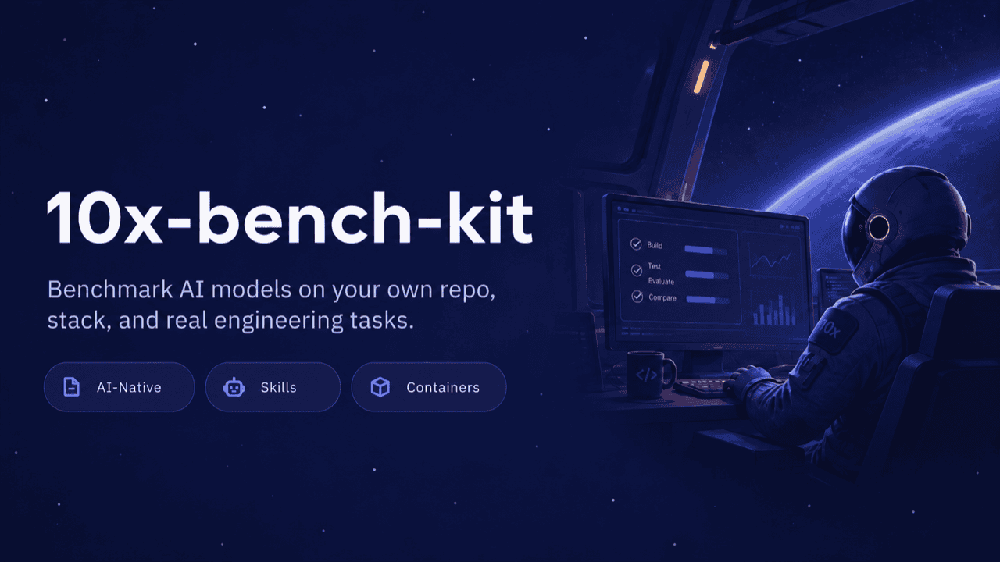

# 10x-bench-kit

A template for your company's AI agent benchmark. Create an instance
with [10xCLI](https://github.com/przeprogramowani/10x-cli), then work
through **skills in your AI coding tool**: define representative tasks,
build them, measure models, and decide which model to use for each
class of work.

**The benchmark is local-first.** Attempts and evaluations run on your
machine or a VPS with a container engine. GitHub Actions handles
readiness checks and optional leaderboard publication. Paid execution
stays on the measurement host.

Trials run in one of three agent CLIs ("harnesses"), all preinstalled in
the trial image at pinned versions: **OpenCode**, **Claude Code**, and
**OpenAI Codex CLI**. The harness is part of the model id, so the same
model in two CLIs shows up as two contestants:

| Model id in `defaults.models` | Runs in | Key |
|---|---|---|
| `openrouter/anthropic/claude-sonnet-5` | OpenCode (no prefix, as before) | `OPENROUTER_API_KEY` |
| `claude-code:claude-sonnet-5` | Claude Code, Anthropic API | `ANTHROPIC_API_KEY` |
| `claude-code:openrouter/anthropic/claude-sonnet-5` | Claude Code via OpenRouter | `OPENROUTER_API_KEY` |
| `codex:gpt-5.1-codex` | Codex CLI, OpenAI API | `OPENAI_API_KEY` |
| `codex:openrouter/openai/gpt-5.1-codex` | Codex CLI via OpenRouter | `OPENROUTER_API_KEY` |

The benchmark measures quality, cost, and execution time. Where a CLI
does not report a trustworthy cost (Codex, or Claude Code routed through
OpenRouter), the runner prices the trial's tokens. Prices come from the
`pricing` map in `bench.config.yaml` or from OpenRouter's public model
catalog, and the source is recorded with the cost. A model that cannot
be priced is refused before any money is spent.

## Get started

You need [10xCLI](https://github.com/przeprogramowani/10x-cli), an AI coding
tool that supports the installed skills, Docker or Podman, Node.js, and
provider API keys in your shell environment.

From your product repository, create a benchmark instance:

```bash
10x bench-kit init my-bench
```

Init registers the product repository as the first base repo and leaves
its working clone in `.repos/`. Open the generated `my-bench` directory
in the AI coding tool you selected during init, then ask:

> Use bench-measure to set up this instance and run the first smoke measurement.

Its preflight checks configuration, container access, and credentials,
then proves that execution and evaluation work locally. Publication is
optional.

**Init and update are the user-facing CLI operations.** All benchmark
work goes through skills. The agent invokes the internal runner and
checks its output as part of each skill's procedure.

## Three concepts: define → measure → decide

The whole workflow is three skills. Name one in your message to the
agent; each loads its detailed procedures only when it needs them.

| Concept | Skill | Example prompts | What you get |
|---|---|---|---|
| **Define** — what we measure | [bench-define](.agents/skills/bench-define/SKILL.md) | “Use bench-define to mine our merged PRs for bugfix tasks.” · “Use bench-define to build the pending backlog.” · “Refresh this expired task.” | Tasks taken from your real work. **PR mining** is the default source: a merged change with tests becomes a task, with its tests as the hidden grader and its code as proof the task is solvable. An interview covers work with no history. Orders tied to a decision land in `tasks/backlog.md`, and built tasks come with evidence in `reports/<task>-build.md`. |
| **Measure** — run models on it | [bench-measure](.agents/skills/bench-measure/SKILL.md) | “Use bench-measure to compare our configured models within the budget.” · “A new model came out — measure it against what we use.” | Preflight (setup, keys, engine), preserved attempts, evaluation (a judge with tools per attempt), actual spend, a reliability-first table. |
| **Decide** — what it means | [bench-decide](.agents/skills/bench-decide/SKILL.md) | “Use bench-decide to show which model and tool we should use for bugfixes.” · “Why did model X fail here?” | A one-page verdict. It covers pass rate with uncertainty, cost per acceptable result and review burden; class × model comparisons that count tasks, not trials; whether a difference is actually resolved; what your task set can resolve and how many tasks a closer call needs; and the time horizon (“reliably handles ~N-minute tasks in your repo”). |

**Why mining matters:** comparing two models on the same tasks resolves
small differences only with many tasks. 10 tasks tell apart a ~70-point
gap, 40 tasks a ~26-point one. `bench backlog` shows this per class of
work, and mining is how you get to dozens of real tasks without
authoring each by hand.

**You review and commit the files.** Skills leave task files, reports, and
results in the working tree; they do not commit or push them. Each skill
ends its handover with a **commit plan**: changes grouped by intent (new
task with its grader and report, new evaluations, a rubric bump with its
re-evaluations, backlog). Each group is marked neutral, data, or
era-closing (needs a PR) and comes with ready `git add` / `git commit`
lines. You review what each group does to comparability rather than a
flat list of paths. If you configure leaderboard publication, pushing
committed results triggers its rebuild.

The configured `defaults.max_cost_usd` limits the measurement run.
Skills project cost before execution and report actual spend afterwards.
Raising the budget requires your approval.

Skill links point to this template's `.agents/skills/` directory. Init
installs them in the directory appropriate for your selected tool; the
selection is recorded in `.bench-kit/instance.json`.

## What an instance keeps

| Location | Contents |
|---|---|
| `tasks/` | Backlog and tasks: pinned starting points, prompts, and overlays. |
| `evaluation-pool/` | Rubrics and execution guards, isolated from the agent solving the task. |
| `bench.config.yaml` | Base repositories, models, judge, budgets, and run defaults. |
| `attempts/` | Preserved trials: workspace, patch, agent log, and execution metrics. |
| `results/` | Evaluated results and verdicts, versioned by you in git. |
| `reports/` | Task-build evidence for review. |
| `.repos/` | Local base-repository clones, excluded from git. |
| `.bench-kit/` | Internal runner and contracts, maintained by the kit. |

## Attempts, evaluation, and comparability

Execution and evaluation are independent. Each trial runs a model against
a task in an isolated container, with no evaluation materials in its
workspace. The attempt preserves the resulting workspace, patch, logs,
and cost metrics on the measurement host.

Evaluation uses a disposable copy of that workspace in a container.
Repository-native execution guards supply facts; the judge assesses the
implementation against the task rubric and can build, test, and inspect
it with tools. Results are written separately to `results/`.

**Preserved attempts can be evaluated again.** A rubric or judge change
uses the existing attempts, avoiding another model execution. Changing
the task itself requires new attempts. Results carry task, rubric, and
judge version information and are comparable only within the same era.
Scoring changes require evidence and a PR that explains their impact on
comparability.

For artifact details, see the [attempt format](.bench-kit/ATTEMPT_FORMAT.md).

## Update an instance

From the benchmark instance directory:

```bash
10x bench-kit update
```

| Zone | Owner | Update behavior |
|---|---|---|
| `.bench-kit/` | Kit | Replaced atomically. |
| Installed skills and `AGENTS.md` | Shared | Proposed diff for your review. |
| Tasks, evaluation materials, configuration, attempts, and results | You | Left untouched. |

Review the proposed shared-file changes and the [changelog](CHANGELOG.md).
Use **bench-measure** if the update requires a wiring check or when a
scoring change calls for re-evaluation of
preserved attempts.
